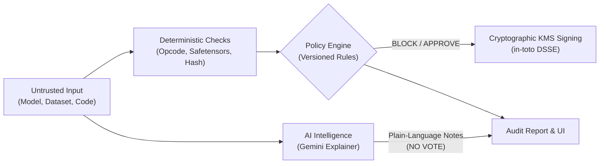
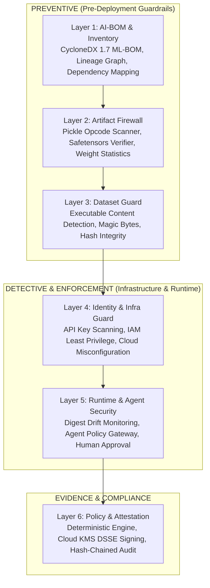
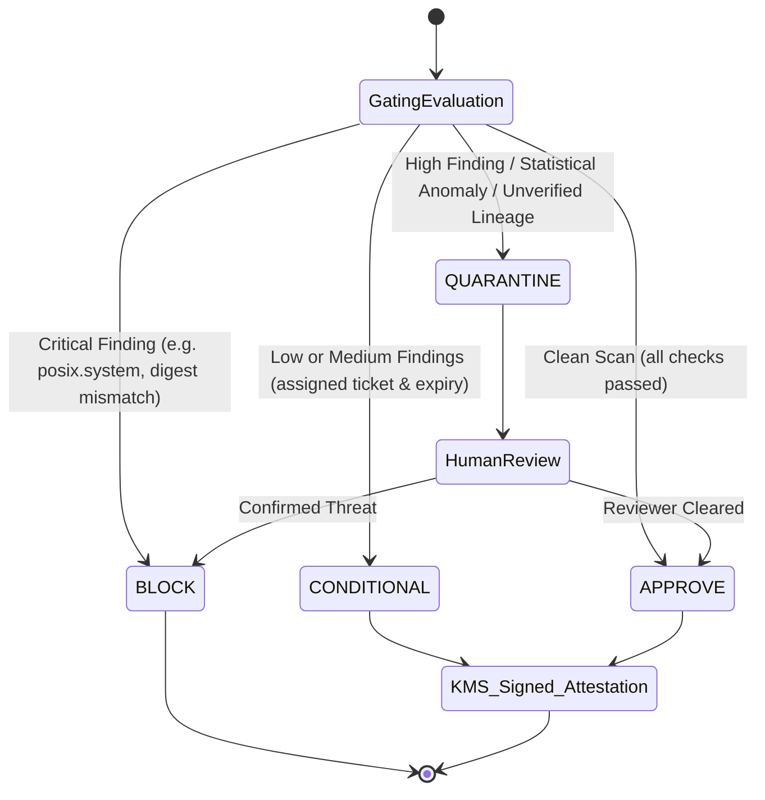
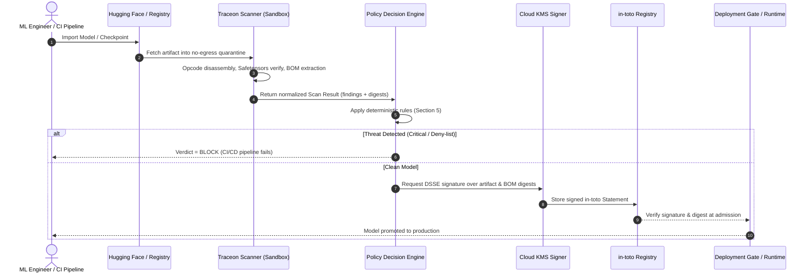
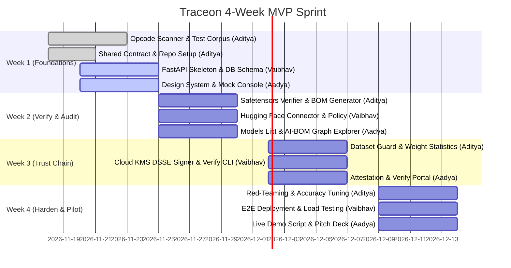

# 🛡️ Traceon: Complete AI Supply Chain Security & Trust Platform

<div align="center">

**Trace Every Layer. Trust Every Model.**

[](LICENSE)
[](https://www.python.org/)
[](https://cyclonedx.org/)
[](https://in-toto.io/)
[](https://cloud.google.com/)

**Team DeepTrace AI** · [GitHub Repository](https://github.com/Aditya-dxt/TRACEON) · `main` branch

</div>

---

## 📌 Table of Contents

- [1. Executive Summary](#1-executive-summary)
- [2. Core Philosophy: LLMs Explain, Deterministic Checks Decide](#2-core-philosophy)
- [3. The Problem: Three Real-World AI Security Incidents](#3-the-problem-real-world-incidents)
- [4. Six-Layer Solution Architecture](#4-six-layer-solution-architecture)
- [5. The Four Policy Verdicts](#5-the-four-policy-verdicts)
- [6. End-to-End Workflow](#6-end-to-end-workflow)
- [7. Team & Strict Lane Ownership](#7-team--strict-lane-ownership)
- [8. Repository Layout](#8-repository-layout)
- [9. The Shared Contract (`contracts/`)](#9-the-shared-contract)
- [10. Quickstart & Installation](#10-quickstart--installation)
- [11. Testing & Validation](#11-testing--validation)
- [12. 4-Week MVP Roadmap](#12-4-week-mvp-roadmap)

---

## 1. Executive Summary

Enterprise security conventionally stops at application source code. Modern enterprise AI, however, ingests gigabyte-scale opaque model weights, unvetted public datasets, complex Python dependency trees, overprivileged cloud service identities, and autonomous agent tool loops.

**Traceon** is an end-to-end AI cybersecurity and trust platform that protects the complete lifecycle of enterprise AI:
- **Preventive**: Intercepts, disassembles, and evaluates models, datasets, and dependencies in isolated, no-egress sandboxes before they enter production pipelines.
- **Detective**: Continuously monitors running model weights, tracks runtime version drift, gates agent tool calls with least-privilege policies, and generates tamper-evident audit trails.
- **Evidentiary**: Issues cryptographically verifiable **CycloneDX 1.7 AI-BOMs** and **Cloud KMS-signed in-toto DSSE attestations** bound to exact cryptographic SHA-256 byte digests.

---

## 2. Core Philosophy

> ### ⚖️ **"LLMs Explain. Deterministic Checks Decide."**
> Critical security verdicts, admission gates, and cryptographic signatures are **never** delegated to an LLM. Probabilistic models read text and generate plain-language explanations for human review. Strict, versioned, deterministic rules over verified byte evidence decide whether an artifact is Approved or Blocked.



---

## 3. The Problem: Real-World Incidents

Modern AI systems suffer from threats that traditional SAST/DAST tools cannot detect:

| Incident | Impact | Attack Vector | Traceon Defense Layer |
| :--- | :--- | :--- | :--- |
| **Ultralytics YOLO** *(Dec 2024)* | 4 compromised PyPI releases | Malicious supply-chain dependency delivering cryptocurrency-mining malware. | **Layer 1 & 2**: Dependency vulnerability graph & hash pinning. |
| **Hugging Face** *(Jul 2026)* | 5 internal datasets accessed | Autonomous agent exploited dataset-processing vulnerabilities to exfiltrate service tokens. | **Layer 3 & 4**: Dataset Guard script detection & IAM secret shielding. |
| **Replit Agent** *(Jul 2025)* | 2,400+ production records deleted | Autonomous coding agent executed unauthorized bulk deletions during a freeze. | **Layer 5**: Agent identity gateway & human approval checkpoints. |

---

## 4. Six-Layer Solution Architecture

Traceon establishes a unified chain of trust across six distinct layers:



### Detailed Layer Breakdown

- **Layer 1: AI-BOM & Inventory**: Standardized CycloneDX 1.7 machine-learning bill of materials linking base models, fine-tuning datasets, hyperparameter configurations, and software packages.
- **Layer 2: AI Artifact Firewall**: Reads serialization structures without executing files. Disassembles pickle opcodes via `pickletools`, validates Safetensors JSON headers/memory offsets, and analyzes tensor norm outliers.
- **Layer 3: Dataset Guard**: Inspects training and fine-tuning datasets for embedded scripts (`.py`, `.sh`), binary executables (PE/ELF), schema corruptions, and manifest checksum mismatches.
- **Layer 4: Identity & Infrastructure Guard**: Audits cloud service accounts, flags overprivileged storage roles, and redacts exposed credentials or API tokens before they enter training pipelines.
- **Layer 5: AI Runtime & Agent Security**: Validates that production inference services serve exact approved SHA-256 digests. Gates autonomous agent tool use with human-in-the-loop approvals for sensitive operations.
- **Layer 6: Trust & Policy Enforcement**: Evaluates normalized findings through versioned deterministic policy rules, producing cryptographically signed attestations via Cloud KMS.

---

## 5. The Four Policy Verdicts

Traceon avoids scoring averages that allow dozens of benign metrics to hide a single critical vulnerability. Artifacts are evaluated through deterministic gating:



| Verdict | Meaning | Action / Effect | Badge |
| :--- | :--- | :--- | :---: |
| **`BLOCK`** | Direct, evidenced, deterministic path to compromise (e.g., deny-listed pickle opcode, digest mismatch). | Immediate CI/CD failure; artifact quarantined; security alert dispatched. | 🔴 |
| **`QUARANTINE`** | High-severity finding with probabilistic confidence, weight distribution anomaly, or unverified dataset source. | Artifact isolated; promotion blocked pending human review queue. | 🟡 |
| **`CONDITIONAL`** | Low or medium findings only (e.g., non-exploitable outdated package). | Temporary admission with assigned security ticket and strict expiry date. | 🔵 |
| **`APPROVE`** | All required checks passed cleanly with no findings above informational. | Cloud KMS generates in-toto DSSE attestation; pipeline admission granted. | 🟢 |

---

## 6. End-to-End Workflow



---

## 7. Team & Strict Lane Ownership

To ensure rapid, parallel development across the 4-week sprint without merge conflicts, team ownership is strictly partitioned by directory:

| Developer | Role | Dedicated Directory | Core Responsibilities |
| :--- | :--- | :--- | :--- |
| **Aditya Dixit** | CEO, AI & Security Lead | `scanner/` | Pickle opcode scanner, Safetensors verifier, Dataset Guard, weight statistics, CycloneDX 1.7 AI-BOM generator, Gemini explainer, synthetic test corpus. |
| **Vaibhav Tripathi** | CTO, Backend & Platform | `backend/`, `infra/` | FastAPI control plane, PostgreSQL database, Cloud Run sandbox worker, Hugging Face connector, policy engine, audit log, Cloud KMS DSSE signing, verify CLI, GitHub Action. |
| **Aadya Pandey** | Product & Design Lead | `frontend/`, `docs/` | Next.js/Tailwind security dashboard, hero finding card, AI-BOM graph explorer, attestation & verify portal, demo scripts, research & pitch deck. |
| **Shared** | All Three | `contracts/` | Canonical JSON Schemas (`finding`, `scan_result`, `verdict`, `attestation`), `api.md`, and mock API datasets. |

---

## 8. Repository Layout

```text
TRACEON/
├── README.md                     # Master platform documentation
├── .gitignore                    # Prevents leaking .env, credentials, & large weights
├── contracts/                    # Shared contract schemas and mock data
│   ├── finding.schema.json       # JSON Schema for an individual finding
│   ├── scan_result.schema.json   # JSON Schema for scanner output
│   ├── verdict.schema.json       # JSON Schema for policy decision
│   ├── attestation.schema.json   # JSON Schema for in-toto DSSE attestation
│   ├── api.md                    # REST API endpoint specifications
│   └── examples/                 # Mock JSON fixtures for UI & offline tests
│       ├── scan_result_malicious.json
│       ├── scan_result_clean.json
│       ├── asset_blocked.json
│       ├── asset_quarantined.json
│       ├── asset_approved.json
│       ├── assets_list.json
│       ├── bom.json
│       ├── attestation.json
│       ├── verify_success.json
│       └── verify_failure.json
├── scanner/                      # [Aditya Dixit] AI & model security analysis
│   ├── corpus/                   # Harmless synthetic test corpus (evil.bin, valid.safetensors, etc.)
│   ├── pickle_scan/              # Safe static pickle opcode disassembler
│   ├── safetensors_verify/       # Header JSON, tensor boundary, & offset validator
│   ├── dataset_guard/            # Dataset inspection & executable script detector
│   ├── weights/                  # Per-tensor numerical statistics & outlier detector
│   ├── bom/                      # CycloneDX 1.7 AI-BOM generator
│   ├── explain/                  # Gemini model-card metadata parser (explanation only)
│   ├── tests/                    # Comprehensive unit tests & schema assertions
│   ├── cli.py                    # Scanner command-line interface
│   ├── config.py                 # Deny-lists, allow-lists, and resource thresholds
│   └── format_detect.py          # Magic-byte detection & streaming SHA-256
├── backend/                      # [Vaibhav Tripathi] Platform API, policy, & signing
│   ├── app/                      # FastAPI endpoints & models
│   ├── policy/                   # Deterministic 4-verdict rule engine
│   ├── signing/                  # Cloud KMS in-toto DSSE signer
│   └── connectors/               # Hugging Face quarantine intake
├── infra/                        # [Vaibhav Tripathi] Cloud infrastructure & CI/CD
│   ├── sandbox/                  # Ephemeral no-egress scan container
│   ├── github_action/            # Attestation verification CI gate
│   └── deploy/                   # Cloud Run and storage deployment config
├── frontend/                     # [Aadya Pandey] Next.js security console
│   ├── src/                      # UI components, views, config
│   └── mock/                     # Mock fixtures
└── docs/                         # [Aadya Pandey] Research, demo, and pitch assets
    ├── demo_script.md            # 5-minute technical demo walkthrough
    └── research/                 # MITRE ATLAS mappings and competitor analysis
```

---

## 9. The Shared Contract

All components in Traceon communicate via strict, versioned JSON data shapes located in `contracts/`:

### A. Individual Finding (`contracts/finding.schema.json`)
```json
{
  "finding_id": "f_001",
  "check": "pickle_opcode",
  "category": "serialization",
  "severity": "critical",
  "confidence": "high",
  "deterministic": true,
  "title": "Deny-listed import in pickle: posix.system",
  "evidence": {
    "module": "posix",
    "callable": "system",
    "offset": "0x0002",
    "file": "evil.bin",
    "sha256": "9bffe8a41a4a4939211e1e229b14f6cc1acff1ff8bea0fe0c452e931bed7ebbf"
  },
  "recommendation": "Do not load this file. Request a Safetensors version."
}
```

### B. CycloneDX 1.7 AI-BOM Specification
Custom metadata is strictly namespaced under `traceon:*` properties to preserve standards compliance:
```json
{
  "bomFormat": "CycloneDX",
  "specVersion": "1.7",
  "metadata": {
    "component": {
      "type": "machine-learning-model",
      "name": "deep-finance-llm",
      "properties": [
        { "name": "traceon:ext", "value": "tw-ext/1" },
        { "name": "traceon:fileFormat", "value": "safetensors" },
        { "name": "traceon:sha256", "value": "4b5d1a8e..." }
      ]
    }
  }
}
```

---

## 10. Quickstart & Installation

### Prerequisites
- Python 3.11+
- Git

### Installation
```bash
# Clone the repository
git clone https://github.com/Aditya-dxt/TRACEON.git
cd TRACEON

# (Optional) Create virtual environment
python -m venv .venv
# Linux/macOS: source .venv/bin/activate
# Windows: .venv\Scripts\Activate.ps1

# Install testing and schema dependencies
pip install pytest jsonschema referencing
```

### CLI Usage

```bash
# 1. Scan a model artifact (Pickle, PyTorch zip, Safetensors, etc.)
python -m scanner.cli scan --file scanner/corpus/evil.bin

# 2. Scan a dataset directory for hidden scripts or hash mismatches
python -m scanner.cli dataset --dir scanner/corpus/dataset_script

# 3. Generate a CycloneDX 1.7 AI-BOM from metadata and scan results
python -m scanner.cli bom --meta metadata.json --scans scan_output.json
```

### Python API Integration
```python
from scanner import scan_artifact, scan_dataset, generate_bom

# Scan model file (returns dictionary conforming to scan_result.schema.json)
result = scan_artifact("path/to/checkpoint.safetensors")

# Scan dataset directory
ds_result = scan_dataset("path/to/dataset_folder")

# Generate CycloneDX 1.7 AI-BOM
bom = generate_bom(model_meta={"name": "my-model", "format": "safetensors"}, scan_results=[result])
```

---

## 11. Testing & Validation

Traceon utilizes a **100% synthetic and harmless test corpus** (`scanner/corpus/`) to guarantee safety during testing:

```bash
# Generate / refresh synthetic corpus
python scanner/corpus/make_corpus.py

# Run the complete test suite
pytest scanner/tests/ -v
```

### Test Coverage Highlights
- ✅ **Pickle Opcode Detection**: Flags `posix.system` with offset `0x0002` without executing code.
- ✅ **Clean Pickle Pass**: Validates primitive pickle objects pass with zero non-informational findings.
- ✅ **Safetensors Verification**: Verifies valid memory bounds and detects past-EOF offset corruptions.
- ✅ **Dataset Guard**: Identifies unexpected embedded `.py` scripts and manifest digest mismatches.
- ✅ **CycloneDX 1.7 Validation**: Validates AI-BOM structure against specifications.
- ✅ **Explainer Safeguard**: Confirms LLM outputs are strictly labeled `explanation` with zero verdicts.
- ✅ **Resilience**: Asserts scanner never raises uncaught exceptions on missing or hostile files.

---

## 12. 4-Week MVP Roadmap



---

<div align="center">

**Built with pride by Team DeepTrace AI**  
*Aditya Dixit (CEO & Security Lead) · Vaibhav Tripathi (CTO & Platform) · Aadya Pandey (Product & Design)*

</div>
